I build interactive products for the web and the tools around them. seven years of react and typescript in brazil, australia and the us, with node, nestjs, .net and postgres behind them. these days most of my time goes into products built with ai agents, and into the gates that check what they write.

react · typescript · next.js · node.js · nestjs · .net · postgres · d3 · firebase · gcp

<h3></h3>

everything here is work in progress. each line says how far along it is.

 
briefings for legislators' offices in brazil, every line with its source · next.js, postgres, pgvector · landing page and app live, code private

 
an idle rpg that plays inside claude code while claude works · typescript, sqlite · playable offline, public server not up yet

 
a chrome extension that fills job applications and never submits one · mv3, sqlite, local only · in progress

 
ai haircut previews for barbers, from one photo of the client · expo, nestjs, supabase · demo live, no store listing

 
drafts, schedules and measures linkedin posts, and a person approves each one · nestjs, postgres · in progress

 
hyperliquid perps analysis with an alert engine that runs all day · fastify, react · in progress

earlier stage: [Harness Bench](https://github.com/kevinshibuya/harness-bench) · [Brazil Elections Dataset Analysis](https://github.com/kevinshibuya/brazil-elections-dataset-analysis) · [Oil Tracker](https://github.com/kevinshibuya/oil-tracker) · [Claude Harness, a case study](https://github.com/kevinshibuya/claude-harness-case-study)

<h3></h3>

 
the chamber of deputies' open data every day, with ai-drafted voting summaries an editor approves · grupo rbs · finished, never launched

 
live polls for the newsroom, 760k votes across 71 polls · grupo rbs · replaced a paid service

 
a live dashboard of r$ 129b in flood-recovery spending for rio grande do sul · grupo rbs · prêmio rbs de jornalismo

 
the sales page for an online course, 97% good lcp · freelance

 
an internal hub where journalists show how they use ai, in video and in articles · grupo rbs

 
zero hora's photographs of the may 2024 floods, eight photographers and a testimony from each · grupo rbs

 
gzh's year in photographs, eight sections driven by the scroll · grupo rbs

and 162 newsroom interactives published on gzh, listed with every case study on [all work](https://kevinshibuya.com/all-work).

I was at grupo rbs from november 2023 to july 2026. that code is private, so the case study shows the architecture.

<h3></h3>

[hello@kevinshibuya.com](mailto:hello@kevinshibuya.com) · [kevinshibuya.com](https://kevinshibuya.com) · [linkedin](https://linkedin.com/in/kevin-shibuya)

porto alegre, brazil · open to remote and relocation · english c1, portuguese native
